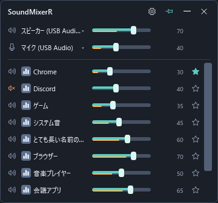

# SoundMixerR 🎚️

Windows 11 x64向けのコンパクトな音量ミキサーです。横スライダーでアプリの音量・ミュート、出力先・入力先を操作できます。

**v0.2.13の配布準備中です。** 下書きリリースはまだ一般公開していません。公開後の配布ZIPは [Releases](https://github.com/mezon-web/SoundMixerR-Releases/releases) に掲載します。

説明用のデモ表示です。機器名・アプリ名は例です。

## 使い方

1. 配布ZIPをフォルダーへ展開し、`SoundMixerR.exe` を起動します。.NETランタイムは同梱しています。
2. 横スライダーで音量を調整し、左の音声ボタンでミュートを切り替えます。青緑は設定音量、その下のオレンジは音声レベルです。
3. 上段の機器名を押すと、Windowsの出力・入力機器を選択できます。設定から標準用と通話用のまとめ変更・個別変更を切り替えられます。
4. アプリ名を押すと「音声の詳細」が開きます。出力先・入力先を選び、その行の「適用」で確定します。「使用状況」から設定先と使用中・待機中の機器を確認できます。
5. 右端の☆／★でアプリを一覧上部に固定できます。固定・通常の各グループ内は名前順です。

アプリの音量・ミュート・メーターは、そのアプリの現在の出力先に対応します。別機器の待機セッションの音量は混ぜません。操作先が確認できない場合は数値を「—」と表示します。

## 表示と終了

- トレイの左クリック、または `Ctrl + Alt + V` で表示を切り替えます。ホットキーは設定から変更できます。
- 通常表示中はタスクバーにも表示します。「最小化時にタスクバーから非表示にする」は初期値ONです。OFFでは最小化してもタスクバーに残ります。
- Esc・トレイの「収納」でトレイへしまいます。外クリックでは収納しません。
- ピンボタンで最前面表示を切り替えます。ヘッダーのドラッグで移動できます。
- ヘッダーの×・Alt+F4・トレイの「終了」でアプリを終了します。
- 設定・詳細を開いている間はメインを操作できません。他のアプリへは切り替えられます。

設定でコンパクト表示とゆったり表示を選べます。起動は手動で、スタートアップ登録機能はありません。

設定は `%LOCALAPPDATA%\SoundMixerR\settings.json` に保存します。更新時はアプリを終了し、新しいZIPを別フォルダーへ展開してください。起動時に過去の音量を強制適用することはありません。

## 制約と検証

アプリ独自の機器指定、排他モード・ASIOなどの音声は、Windows共有ミキサーの操作が反映されない場合があります。機器変更の成功はWindowsの設定値を読み戻して確認します。実際の再生・録音・送信はアプリ側でも確認してください。

マイク音量・ミュートは機器共通です。アプリごとのマイク音量バーは設けていません。アプリ別の機器設定はWindowsの非公開APIを使用し、対応しない環境では取得・変更エラーを表示します。

検証はローカルで行い、GitHub Actionsは使用しません。隔離Windowsデスクトップの検査と、物理操作・実音・実OSのDPI変更は区別しています。詳しくは [v0.2.13の検証結果](docs/verification-v0.2.13.md) を参照してください。

## このリポジトリについて

このリポジトリは利用者向けの文書・確認済み画像・配布物を管理します。アプリのソースは非公開です。
GitHubが自動表示する「Source code」は、この配布リポジトリの説明書・画像のアーカイブです。アプリ本体は正式な配布ZIPから入手してください。

[変更履歴](CHANGELOG.md) / [第三者ソフトウェアの表記](SOUNDMIXERR-NOTICES.txt)
