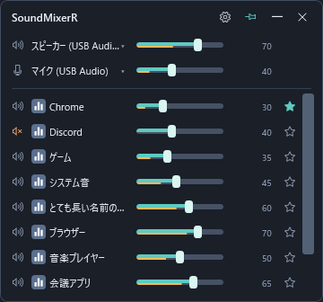

# SoundMixerR 🎚️

Windows 11 x64向けのコンパクトな音量ミキサーです。横スライダーでアプリの音量・ミュート、出力先・入力先を操作できます。

## ダウンロード

**[SoundMixerR v0.2.19をダウンロード（Windows 11 x64・ZIP・約72 MB）](https://github.com/mezon-web/SoundMixerR-Releases/releases/download/v0.2.19/SoundMixerR-v0.2.19-win-x64.zip)**

- [SHA-256](https://github.com/mezon-web/SoundMixerR-Releases/releases/download/v0.2.19/SHA256SUMS.txt) / [更新内容](https://github.com/mezon-web/SoundMixerR-Releases/releases/tag/v0.2.19)
- .NET 10ランタイムを同梱しています。Windows 11 x64で検証しています。
- ZIPをすべて新しいフォルダーへ展開して、`SoundMixerR.exe`を起動してください。

説明用のデモ表示です。機器名・アプリ名は例です。

v0.2.19では画面更新時の並べ替え・説明文・描画用オブジェクトの再生成を減らしました。同じ模擬条件で、一時メモリ割り当て量は約91%減りました。[測定条件と検証結果](docs/verification-v0.2.19.md)を参照してください。

## 使い方

1. ZIPをすべて展開し、版番号付きフォルダーのSoundMixerR.exeを起動します。同じフォルダーの使い方.htmlで操作説明を読めます。
2. 横スライダーで音量を調整し、左の音声ボタンでミュートを切り替えます。青緑は設定音量、その下のオレンジは音声レベルです。
3. 上段の機器名を押すと、Windowsの出力・入力機器を選択できます。設定から標準用と通話用のまとめ変更・個別変更を切り替えられます。
4. アプリ名を押すと「音声の詳細」が開きます。出力先・入力先を選び、その行の「適用」で確定します。「使用状況」から設定先と使用中・待機中の機器を確認できます。
5. 右端の☆／★でアプリを一覧上部に固定できます。固定・通常の各グループ内は名前順です。

上段の出力・マイクを操作中に既定機器が変わるか切断された場合は、その操作を中止します。キーを離して押し直すか、新しいマウス操作から再開してください。

アプリの音量・ミュート・メーターは、そのアプリの現在の出力先に対応します。別機器の待機セッションの音量は混ぜません。操作先が確認できない場合は数値を「—」と表示します。

TeamsなどのWebView2音声も、WindowsのアプリIDから登録名を取得できればアプリ名を表示します。取得できない場合はプロセス名などを表示します。

Windowsに登録されたパッケージアプリのアイコンも取得して表示します。起動時は保存位置への配置を終えてから画面を表示します。

## 表示と終了

- トレイの左クリック、または `Ctrl + Alt + V` で表示を切り替えます。ホットキーは設定から変更できます。
- 通常表示中はタスクバーにも表示します。「最小化時にタスクバーから非表示にする」は初期値ONです。OFFでは最小化してもタスクバーに残ります。
- Esc・トレイの「収納」でトレイへしまいます。外クリックでは収納しません。
- ピンボタンで最前面表示を切り替えます。ヘッダーのドラッグで移動できます。
- ヘッダーの×・Alt+F4では「終了しますか？」を表示し、OKで終了します。キャンセル・Esc・確認画面の×で戻れます。トレイ・設定の明示的な終了は確認なしで終了します。
- 設定・詳細を開いている間はメインを操作できません。他のアプリへは切り替えられます。

設定でコンパクト表示とゆったり表示を選べます。起動は手動で、スタートアップ登録機能はありません。

設定は `%LOCALAPPDATA%\SoundMixerR\settings.json` に保存します。更新時はアプリを終了し、新しいZIPを別フォルダーへ展開してください。起動時に過去の音量を強制適用することはありません。

## 制約と検証

アプリ独自の機器指定、排他モード・ASIOなどの音声は、Windows共有ミキサーの操作が反映されない場合があります。機器変更の成功はWindowsの設定値を読み戻して確認します。実際の再生・録音・送信はアプリ側でも確認してください。

マイク音量・ミュートは機器共通です。アプリごとのマイク音量バーは設けていません。アプリ別の機器設定はWindowsの非公開APIを使用し、対応しない環境では取得・変更エラーを表示します。

状態・UIと展開EXEの起動・終了をローカルで検査しています。検証範囲と未確認事項は [v0.2.19の検証結果](docs/verification-v0.2.19.md) を参照してください。

## このリポジトリについて

このリポジトリは利用者向けの文書・確認済み画像・配布物を管理します。アプリのソースは非公開です。
GitHubが自動表示する「Source code」は、この配布リポジトリの説明書・画像のアーカイブです。アプリ本体は正式な配布ZIPから入手してください。

[変更履歴](CHANGELOG.md) / [第三者ソフトウェアの表記](SOUNDMIXERR-NOTICES.txt)
